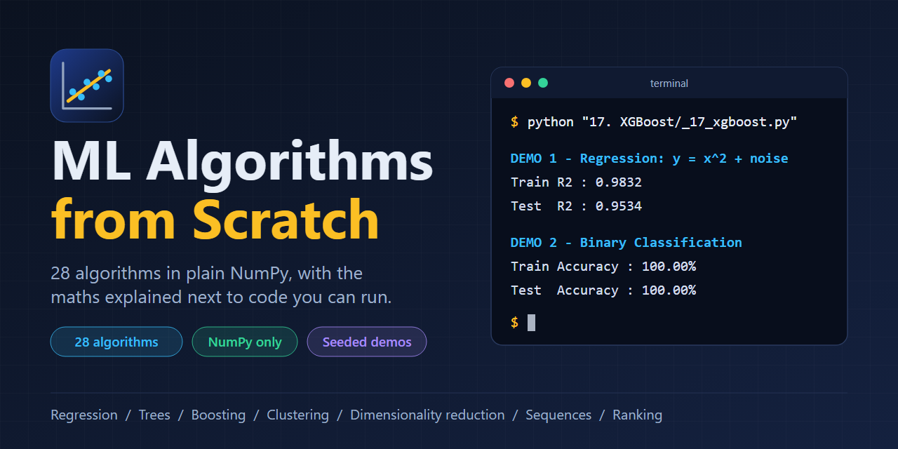
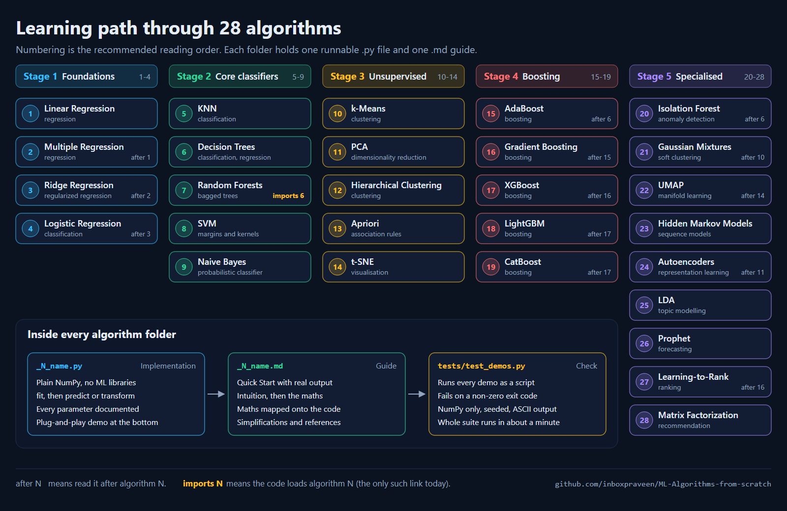

# Machine Learning Algorithms from Scratch



[](https://www.python.org/)
[](https://numpy.org/)
[](#algorithms-included)
[](LICENSE)
[](https://github.com/sponsors/inboxpraveen)

Twenty-eight machine learning algorithms implemented in plain NumPy, from linear regression to
XGBoost, UMAP and learning-to-rank. Each one comes with a runnable demo and a guide that
explains the mathematics and maps it onto the code. Run a file, watch the model train, then
read why it works.

**Built for**

- Students learning machine learning fundamentals
- Developers who want to understand algorithms rather than call them
- Data scientists preparing for technical interviews
- Instructors who need runnable, reproducible examples for a course

## Why learn algorithms from scratch?

Libraries like scikit-learn are powerful, and they hide the inner workings. Implementing an
algorithm yourself lets you:

- **See the maths become code**: every formula in a guide points at the lines that implement it
- **Debug with confidence**: you know what happens under the hood when results look wrong
- **Tune with understanding**: you see what each hyperparameter changes and why
- **Answer interview questions**: you can explain the algorithm, not only name it

## Features

- **Runs out of the box**: `python "<any file>"` trains a model and prints results. NumPy only,
  no setup, no dataset to download.
- **Reproducible**: every demo is seeded, so you get the same numbers the guide quotes.
- **Math and code side by side**: equations explained in plain language, then mapped onto code.
- **Checked against the real thing**: compared with scikit-learn or SciPy where they have an
  equivalent, and with the original papers where they do not.
- **Honest about shortcuts**: where an implementation simplifies the canonical algorithm, its
  guide says so and explains the cost.
- **Tested**: a small suite runs all 28 demos and fails on any error. See [Verification](#verification).

## Quick start

You need Python 3.10 or newer.

```bash
git clone https://github.com/inboxpraveen/ML-Algorithms-from-scratch.git
cd ML-Algorithms-from-scratch
pip install numpy
```

Pick any file and run it:

```bash
python "1. Linear Regression/_1_linear_regressions.py"
python "17. XGBoost/_17_xgboost.py"
python "23. Hidden Markov Models/_23_hmm.py"
```

Each file ends in a **plug-and-play demo** that builds a small synthetic dataset, trains the
model, and prints training and test scores plus a few sample predictions. The matching `.md`
guide opens with a **Quick Start** that contains the same script and its expected output, so
you can read what a model does before you read how it works.

To use an algorithm on your own data, most of them share one interface:

1. Create an instance of the class
2. Train it with `.fit(X_train, y_train)`
3. Predict with `.predict(X_test)`
4. Evaluate with `.score(X_test, y_test)`

Dimensionality reduction (PCA, t-SNE, UMAP, Autoencoders) uses `.fit_transform(X)`, and
clustering adds `.fit_predict(X)`. Algorithms with a different natural shape, such as Apriori,
the HMM, Prophet, Learning-to-Rank and Matrix Factorization, keep the API that suits them and
document it in their own guide.

## Algorithms included

| #  | Algorithm | Family | Guide |
|----|-----------|--------|-------|
| 1 | Linear Regression | Regression | [Read the guide](1.%20Linear%20Regression/_1_linear_regression.md) |
| 2 | Multiple Regression | Regression | [Read the guide](2.%20Multiple%20Regression/_2_multiple_regression.md) |
| 3 | Ridge Regression | Regularized regression | [Read the guide](3.%20Ridge%20Regression/_3_ridge_regression.md) |
| 4 | Logistic Regression | Classification | [Read the guide](4.%20Logistic%20Regression/_4_logistic_regression.md) |
| 5 | K-Nearest Neighbors (KNN) | Classification | [Read the guide](5.%20KNN/_5_knn.md) |
| 6 | Decision Trees | Classification and regression | [Read the guide](6.%20Decision%20Trees/_6_decision_trees.md) |
| 7 | Random Forests | Ensemble (bagging) | [Read the guide](7.%20Random%20Forests/_7_random_forests.md) |
| 8 | Support Vector Machines (SVM) | Classification | [Read the guide](8.%20SVM/_8_svm.md) |
| 9 | Naive Bayes | Probabilistic classification | [Read the guide](9.%20Naive%20Bayes/_9_naive_bayes.md) |
| 10 | k-Means Clustering | Clustering | [Read the guide](10.%20k-Means%20Clustering/_10_kmeans_clustering.md) |
| 11 | Principal Component Analysis (PCA) | Dimensionality reduction | [Read the guide](11.%20PCA/_11_pca.md) |
| 12 | Hierarchical Clustering | Clustering | [Read the guide](12.%20Hierarchical%20Clustering/_12_hierarchical_clustering.md) |
| 13 | Apriori (Association Rule Mining) | Association rules | [Read the guide](13.%20Apriori/_13_apriori.md) |
| 14 | t-Distributed Stochastic Neighbor Embedding (t-SNE) | Visualization | [Read the guide](14.%20t-SNE/_14_tsne.md) |
| 15 | AdaBoost (Adaptive Boosting) | Ensemble (boosting) | [Read the guide](15.%20AdaBoost/_15_adaboost.md) |
| 16 | Gradient Boosting | Ensemble (boosting) | [Read the guide](16.%20Gradient%20Boosting/_16_gradient_boosting.md) |
| 17 | XGBoost (Extreme Gradient Boosting) | Ensemble (boosting) | [Read the guide](17.%20XGBoost/_17_xgboost.md) |
| 18 | LightGBM (Light Gradient Boosting Machine) | Ensemble (boosting) | [Read the guide](18.%20LightGBM/_18_lightgbm.md) |
| 19 | CatBoost (Categorical Boosting) | Ensemble (boosting) | [Read the guide](19.%20CatBoost/_19_catboost.md) |
| 20 | Isolation Forest | Anomaly detection | [Read the guide](20.%20Isolation%20Forest/_20_isolation_forest.md) |
| 21 | Gaussian Mixture Models (GMM) | Probabilistic clustering | [Read the guide](21.%20Gaussian%20Mixture%20Models/_21_gmm.md) |
| 22 | UMAP (Uniform Manifold Approximation and Projection) | Manifold learning | [Read the guide](22.%20UMAP/_22_umap.md) |
| 23 | Hidden Markov Models (HMM) | Sequence models | [Read the guide](23.%20Hidden%20Markov%20Models/_23_hmm.md) |
| 24 | Autoencoders | Representation learning | [Read the guide](24.%20Autoencoders/_24_autoencoders.md) |
| 25 | Latent Dirichlet Allocation (LDA) | Topic modelling | [Read the guide](25.%20LDA/_25_lda.md) |
| 26 | Prophet (Time Series Forecasting) | Forecasting | [Read the guide](26.%20Prophet/_26_prophet.md) |
| 27 | Learning-to-Rank (LambdaRank) | Ranking | [Read the guide](27.%20Learning-to-Rank/_27_learning_to_rank.md) |
| 28 | Matrix Factorization (Collaborative Filtering) | Recommendation | [Read the guide](28.%20Matrix%20Factorization/_28_matrix_factorization.md) |

## Learning path

The numbering is the recommended order, because each algorithm leans on ideas from the ones
before it. Work through the stages rather than jumping to the famous names at the end.



**Stage 1, Foundations (1-4).** Start with **Linear Regression**: one feature, a closed-form
solution, and the whole idea of fitting a model to data. **Multiple Regression** generalises
it to many features, **Ridge Regression** introduces regularization and your first encounter
with the bias-variance trade-off, and **Logistic Regression** turns regression into
classification and brings in gradient descent.

**Stage 2, Core classifiers (5-9).** **KNN** is the simplest classifier and needs no training.
**Decision Trees** introduce splitting criteria and are the most useful prerequisite in the
repository, since seven later algorithms are tree ensembles. **Random Forests** show why
averaging many decorrelated models beats one good one. **SVM** brings margins and the kernel
trick, and **Naive Bayes** brings the probabilistic view.

**Stage 3, Unsupervised learning (10-14).** **k-Means** and **Hierarchical Clustering** find
structure without labels, **PCA** introduces dimensionality reduction through eigenvectors,
**Apriori** mines association rules, and **t-SNE** visualizes high-dimensional data. Take
t-SNE alongside PCA.

**Stage 4, Boosting (15-19).** Read these in order; they are a single conversation.
**AdaBoost** trains models on the mistakes of earlier ones, **Gradient Boosting** reframes
that as gradient descent in function space, and **XGBoost** adds second-order optimization
and regularization. **LightGBM** and **CatBoost** then each change one thing: leaf-wise growth,
and ordered target statistics for categorical features.

**Stage 5, Specialised methods (20-28).** Pick by what you need: anomaly detection
(**Isolation Forest**), probabilistic clustering (**GMM**), manifold learning (**UMAP**),
sequence models (**HMM**), neural representation learning (**Autoencoders**), topic modelling
(**LDA**), forecasting (**Prophet**), search ranking (**Learning-to-Rank**), and
recommendations (**Matrix Factorization**).

Run the file first, then read the maths. Watching a model score 0.98 and then finding out why
is a better order than the reverse.

## What each algorithm includes

- **A guide** (`.md`) with a Quick Start and its real output, intuition and analogies, the
  mathematics derived step by step and mapped onto the code, worked examples, a
  **Simplifications** section where the code departs from the canonical algorithm, and links
  to the original papers.
- **An implementation** (`.py`) with class-based code, a docstring for every method that
  states its formula, every parameter documented with type, default, effect and typical
  range, inline comments at each non-obvious step, and the plug-and-play demo.

How the pieces fit together, and why the repository is laid out this way, is described in
[docs/ARCHITECTURE.md](docs/ARCHITECTURE.md).

## Verification

```bash
pip install pytest
python -m pytest
```

The suite runs every algorithm as a script and checks that it exits cleanly, prints output and
prints only ASCII. It also checks that the folders are numbered 1 to 28 and that every link in
this README resolves.

All 28 demos pass on Python 3.10, 3.11 and 3.12 with NumPy 2.2 to 2.5. The whole set takes
roughly a minute on a laptop, and the slowest single demo (UMAP) takes under 20 seconds. The
exact versions and timings are in [docs/ARCHITECTURE.md](docs/ARCHITECTURE.md#verification).

## Frequently asked questions

**Can I use this code in production?**
These are reference implementations that prioritize clarity and correctness over speed.
They work well for teaching, interview preparation, prototyping an idea, and as a readable
oracle to compare another implementation against. For real data volumes use an optimized
library such as scikit-learn, XGBoost, PyTorch or TensorFlow.

**How close are these to the real thing?**
Close on the mathematics, not on the engineering. The goal is that each algorithm behaves like
the canonical one: same update rules, same objective, comparable accuracy on the same data.
What you will not find is the engineering that makes production libraries fast: histogram-based
split finding at scale, multithreading, cache-aware memory layouts, GPU kernels or distributed
training. A from-scratch tree here may be 20 to 300 times slower than scikit-learn's while
producing very similar predictions. That trade is deliberate.

**Can I compare these with scikit-learn?**
Yes, and you should. Where scikit-learn or SciPy has an equivalent, the results are expected to
match closely. Where no library exists (XGBoost, LightGBM, CatBoost, UMAP, HMM, Prophet,
Learning-to-Rank, Matrix Factorization), the implementation is checked against the formulas in
the original paper and against problems with a known answer. Each guide's **Simplifications**
section lists the deliberate differences.

**Do I need advanced maths?**
Basic knowledge helps, and each guide explains its maths in plain language before using it.

**Why NumPy only?**
To focus on fundamentals. Knowing what NumPy operations do helps you understand what the
libraries do internally.

## Contributing

Contributions are welcome: bug reports, clearer explanations, checks against the canonical
algorithm, and new algorithms. [CONTRIBUTING.md](CONTRIBUTING.md) covers setup, the rules for
code and guides, and how to run the tests. The short version: clarity matters, correctness
matters more, and every number in a guide must come from a real run.

## Support this project

If this repository helped you:

- [Sponsor the project](https://github.com/sponsors/inboxpraveen) to fund new algorithms and
  keep the guides current
- Star the repository so other learners can find it
- Share it with a classmate, a colleague or a course
- Open an issue or a pull request with a fix or an idea

To cite the repository, use the "Cite this repository" button on GitHub, which reads
[CITATION.cff](CITATION.cff).

## Further reading

- [NumPy documentation](https://numpy.org/doc/stable/)
- [scikit-learn documentation](https://scikit-learn.org/)
- [Machine Learning course (Andrew Ng)](https://www.coursera.org/learn/machine-learning)
- [Deep Learning book](https://www.deeplearningbook.org/)
- [StatQuest on YouTube](https://www.youtube.com/user/joshstarmer) for visual explanations

## License

This project is licensed under the GNU General Public License v3.0. See the
[LICENSE](LICENSE) file for details.

Maintained by [@inboxpraveen](https://github.com/inboxpraveen).
