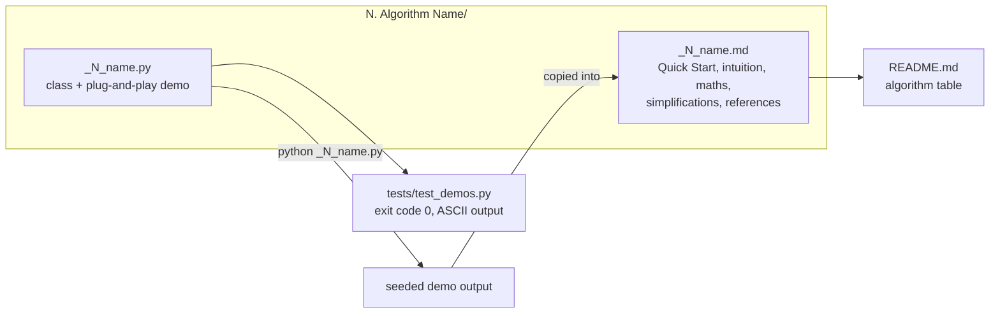
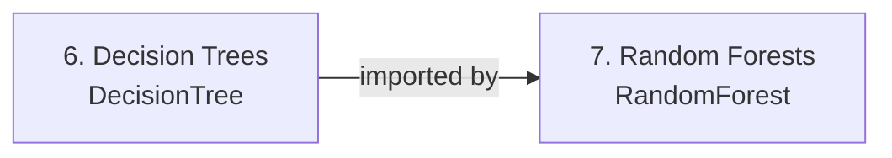
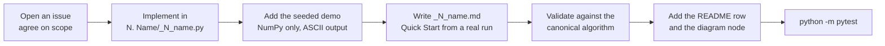

# Architecture

This repository is a library of reference implementations plus the teaching material that
goes with them. There is no framework and no shared base class. Each algorithm is one
self-contained Python file and one Markdown guide, and a small test suite keeps the whole
set runnable.

## Goals and non-goals

**Goals**

- Show how each algorithm works with nothing but NumPy.
- Keep every file runnable on its own and every demo reproducible.
- Say plainly where an implementation differs from the canonical algorithm.

**Non-goals**

- Speed. These are not tuned for large data, threads, GPUs or sparse input.
- A packaged library with a stable API. The code is meant to be read, run and copied.

## Repository map

```
ML-Algorithms-from-scratch/
├── 1. Linear Regression/ ... 28. Matrix Factorization/
│   ├── _N_name.py        implementation and plug-and-play demo
│   └── _N_name.md        guide: Quick Start, intuition, maths, simplifications
├── tests/test_demos.py   smoke tests for every algorithm and for the README links
├── docs/ARCHITECTURE.md  this file
├── assets/               banner, logo, learning-path diagram, social preview
├── CONTRIBUTING.md       how to set up, test and add an algorithm
├── CITATION.cff          how to cite the repository
└── requirements.txt      numpy
```

## Learning path

The numbering is the recommended reading order. Later algorithms lean on ideas from earlier
ones, so the stages build on each other.


| Stage | Algorithms | What it covers |
|-------|------------|----------------|
| 1. Foundations | 1 to 4 | Fitting a model, regularization, gradient descent, classification |
| 2. Core classifiers | 5 to 9 | KNN, decision trees, random forests, SVM, Naive Bayes |
| 3. Unsupervised | 10 to 14 | Clustering, PCA, association rules, t-SNE |
| 4. Boosting | 15 to 19 | AdaBoost, gradient boosting, XGBoost, LightGBM, CatBoost |
| 5. Specialised | 20 to 28 | Anomaly detection, mixtures, UMAP, HMM, autoencoders, topics, forecasting, ranking, recommenders |

## Anatomy of one algorithm

Every folder has the same shape, and every folder is checked the same way.



### The implementation file

- One or more plain NumPy classes. Every parameter is documented with its type, default,
  effect and a typical range, and every method states the formula it implements.
- A consistent interface where one makes sense: `fit(X, y)`, then `predict(X)` and
  `score(X, y)`. Classifiers add `predict_proba`. Transformers (PCA, t-SNE, UMAP,
  autoencoders, LDA) use `fit_transform(X)`. Clustering adds `fit_predict(X)`.
- Algorithms with a different natural shape keep it: Apriori mines itemsets, the HMM decodes
  sequences, Prophet forecasts, Learning-to-Rank returns rankings, Matrix Factorization
  recommends items. Each guide documents its own API.
- A demo under `if __name__ == "__main__":` that builds a small synthetic dataset, trains the
  model and prints its scores. It uses NumPy only, seeds with `np.random.seed(42)`, prints
  ASCII and finishes in seconds.

### The guide

The guide opens with a **Quick Start** containing the demo script and the output it really
produces. It then builds up the intuition, derives the mathematics, maps the formulas onto
the lines that implement them, and ends with advantages, limitations and references. Where
the implementation simplifies the canonical algorithm, a **Simplifications** section names
the difference and what it costs.

## Dependencies between files

Files are independent so that you can copy a single one into a notebook or a course. The one
exception is deliberate:



`_7_random_forests.py` adds the sibling `6. Decision Trees` folder to `sys.path` and
subclasses `DecisionTree`, because a random forest is a decision tree grown on a random
subset of features. If you copy it elsewhere, paste the `DecisionTree` class into the file
as the comment at the top of that file explains. The executable code of every other file
imports NumPy and the standard library only. Usage examples inside docstrings and guides
sometimes use scikit-learn for a dataset or a comparison, and matplotlib for a plot, but
nothing runs them for you. The boosting files do not import chapter 6:
`_16_gradient_boosting.py`, for example, ships its own tree builder.

## Verification

`python -m pytest` runs `tests/test_demos.py`, which checks that:

1. the folders are numbered 1 to 28 with no gaps;
2. each folder has exactly one implementation file and one guide with a Quick Start;
3. each file runs as a script in a fresh interpreter, exits with code 0, prints output and
   prints only ASCII;
4. every relative link in `README.md` points at a file that exists.

The suite was run on three Python and NumPy combinations, all 28 demos passing on each:

| Python | NumPy | Whole demo run |
|--------|-------|----------------|
| 3.10.20 | 2.2.6 | 57 s |
| 3.11.18 | 2.4.6 | 55 s |
| 3.12.13 | 2.5.1 | 45 s |

Timings are wall-clock on one Windows machine and will differ on yours. The slowest single
demo is UMAP at about 17 s on Python 3.11.

Beyond "does it run", each guide records how its results compare with scikit-learn or SciPy
where an equivalent exists, and with the original paper or a hand-computed case where none
does. Those comparisons live in the guides, next to the code they describe.

## Adding an algorithm



The rules for each step are in [CONTRIBUTING.md](../CONTRIBUTING.md). The learning-path
diagram is a generated SVG; edit `assets/architecture.svg` and re-export
`assets/architecture.png` when you add a node.

## Using this beyond reading

- **As a teaching resource.** Point a course or onboarding plan at the numbered path. The
  deterministic demos make good live-coding starting points.
- **As an oracle.** The implementations are small enough to read in one sitting, which
  makes them useful for checking another implementation of the same algorithm.
- **As copy-and-adapt code.** Each file is standalone apart from Random Forests, and the
  license terms are in [LICENSE](../LICENSE).

For workloads with real data volumes, use an optimized library. A from-scratch tree here
can be 20 to 300 times slower than scikit-learn's while producing similar predictions, and
the repository has none of the engineering that closes that gap: histogram split finding,
multithreading, cache-aware layouts, GPU kernels or distributed training.
